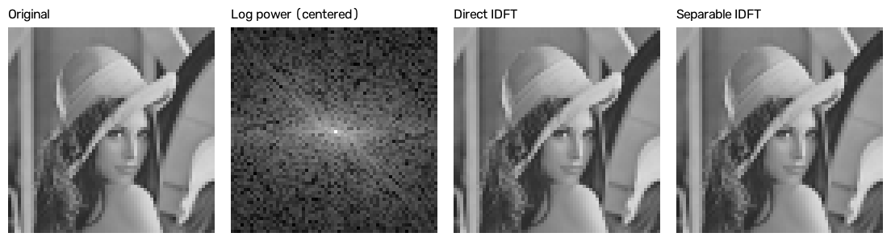

# DZO cvičenie 5 – Inverzná diskrétna Fourierova transformácia

Riešenie [zadania IDFT](https://geordi.github.io/cv-courses/idft_en.html)
v C++17. OpenCV slúži na načítanie, zmenu veľkosti, uloženie a zobrazenie
obrazov. Všetky Fourierove súčty sú implementované ručne; program nepoužíva
`cv::dft`, `cv::idft` ani knižničnú FFT.

Aktuálna stránka IDFT obsahuje sedem úloh a nemá obrázok „Expected Output“.
Taký obrázok je na stránke predchádzajúceho DFT cvičenia a zobrazuje spektrá.
Výstup tohto riešenia preto ukazuje pôvodný obraz, centrované logaritmické
výkonové spektrum a rekonštrukcie oboma IDFT. Obe rekonštrukcie sú po prevode
na 8-bitový obraz pixelovo totožné so spracovaným vstupom.

## Spustenie

V PowerShelli:

```powershell
cd D:\DZOall\DZOcviko5
.\run.cmd
```

Spúšťač automaticky skompiluje `main.cpp` do `build/dzo_idft.exe`, nastaví
cestu k DLL, vykoná kontroly, vytvorí PNG a CSV výstupy a otvorí prehľadové
okno. Okno zavrie ľubovoľná klávesa. Potrebný je MSYS2 MinGW64 kompilátor
a OpenCV v `C:\msys64\mingw64`, ktoré sú na tomto počítači nainštalované.
CMake nie je potrebný.

```powershell
.\run.cmd --no-show                 # výpočet a uloženie bez okna
.\run.cmd --self-test               # iba automatické matematické kontroly
.\run.cmd --no-benchmark            # vynechanie tabuľky časov
.\run.cmd "D:\obrazky\foto.png" --size 64 --no-show
```

Predvolený vstup `images/lena_gray.png` je lokálna kópia sivého obrazu
z cvičenia 4. Pred výpočtom sa zmenší na 64 × 64 pixelov. Parameter `--size`
prijíma 1 až 128; ide o stranu štvorcového spracovaného obrazu. Vyššie
rozmery sú pri priamej IDFT výrazne pomalšie. Program porovnáva rekonštrukciu
s týmto zmenšeným vstupom, nie s pôvodnou fotografiou v plnom rozlíšení.

## Výpočet a normalizácia

Priama IDFT používa štyri vnorené cykly:

```text
f(m,n) = 1/sqrt(M*N) * sum_k sum_l F(k,l) * exp(+i*2*pi*(m*k/M+n*l/N))
```

Separable transformácia používa `transform1D(input, sign)` najprv na riadky,
potom na stĺpce. Znamienko je `-1` pre DFT a `+1` pre IDFT. Každý 1D
výsledok sa delí `sqrt(L)`, takže celková normalizácia je `1/sqrt(M*N)`
v oboch smeroch. Žiadne ďalšie delenie `M*N` sa pri inverzii nepridáva.
Spektrum aj medzivýsledky sú `std::complex<double>`.

Rekonštrukcia používa pôvodné komplexné spektrum, nikdy jeho vizualizáciu.
`shift(..., false)` realizuje `fftshift`, `shift(..., true)` realizuje
`ifftshift`. Ich opačné kruhové posuny fungujú aj pri nepárnych rozmeroch.
Používa sa reálna časť rekonštrukcie; absolútna hodnota by stratila znamienko.
Až pri ukladaní sa reálna hodnota zaokrúhli a ohraničí na 0 až 255.

## Overenie všetkých úloh

Program pred konverziou na PNG vypisuje:

- `E_max = max |Re(reconstruction) - input|`,
- `I_max = max |Im(reconstruction)|`,
- maximum absolútnej hodnoty komplexného rozdielu priamej a separovateľnej IDFT.

Kontroly pokrývajú konštantný aj nekonštantný obraz rozmerov 3 × 5,
6 × 4, 1 × 1, 1 × 7 a 5 × 1, záporné hodnoty a samostatný komplexný vstup.
Overujú celý cyklus DFT → IDFT, obe inverzie, DC koeficient konštantného
obrazu, nulové ostatné koeficienty a cyklus s centrovaním a odcentrovaním.
Pri chybe nad toleranciu `1e-7` program skončí s nenulovým návratovým kódom.

Pri overenom behu pre Lenu 64 × 64:

| Kontrola | Výsledok |
|---|---:|
| Priama IDFT – E_max | 6.111e-12 |
| Priama IDFT – I_max | 6.033e-12 |
| Separovateľná IDFT – E_max | 5.741e-12 |
| Separovateľná IDFT – I_max | 6.864e-12 |
| Maximálny komplexný rozdiel oboch IDFT | 3.998e-12 |
| Maximálny rozdiel po prevode na 8 bitov | 0 |

## Časová zložitosť

Meranie používa rovnaké rozmery ako zadanie DFT. Pre každý rozmer sa
vopred pripraví jedno spektrum a oba algoritmy dostanú ten istý vstup.
Čas zahŕňa len volanie inverznej transformácie vrátane jej alokácií,
nie načítanie, doprednú DFT, konverziu, overovanie alebo zobrazovanie.
Uvádza sa medián troch behov.

Príklad nameraných časov na tomto počítači:

| N | Priama IDFT (ms) | Separovateľná IDFT (ms) |
|---:|---:|---:|
| 8 | 0.2601 | 0.0673 |
| 16 | 4.1942 | 0.4941 |
| 32 | 67.3824 | 4.1473 |
| 64 | 1022.52 | 30.7822 |

Zdvojnásobenie strany zvýšilo čas priamej metódy približne 15–16-krát,
čo zodpovedá `O(N^4)`. Pri separovateľnej metóde išlo približne o 7–8-násobok,
v súlade s `O(N^3)`. Všeobecne sú zložitosti `O(M²N²)` a `O(MN(M+N))`.
Časy závisia od hardvéru a zaťaženia; nové meranie sa uloží do `benchmark.csv`.

## Súbory

| Súbor | Obsah |
|---|---|
| `main.cpp` | Vlastná DFT/IDFT, kontroly, meranie a vizualizácia |
| `run.cmd` | Automatická kompilácia a spustenie |
| `images/lena_gray.png` | Vstupný obraz |
| `image.png` | Skutočne spracovaný vstup 64 × 64 |
| `power.png` | Centrované `log(1 + abs(F)^2)`, normalizované na zobrazenie |
| `idft_direct.png` | Rekonštrukcia priamou IDFT |
| `idft_separable.png` | Rekonštrukcia separovateľnou IDFT |
| `difference.png` | Absolútny rozdiel vstupu a 8-bitovej separovateľnej rekonštrukcie (čierny) |
| `result_images.png` | Prehľad štyroch obrazov s popismi |
| `benchmark.csv` | Namerané časy, pomery rastu a rozdiely inverzií |


