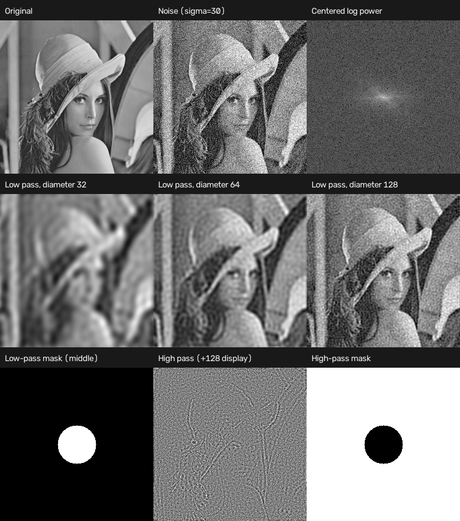
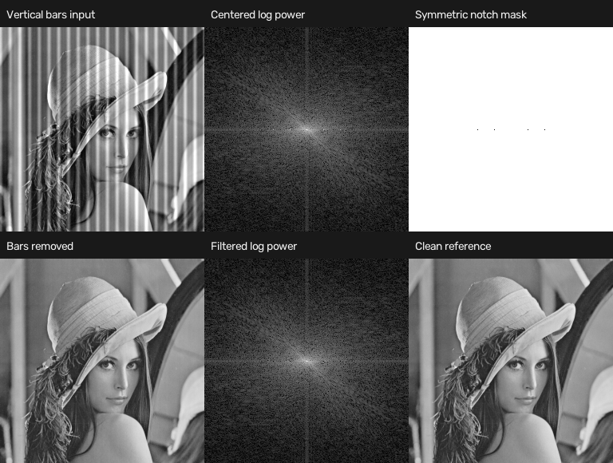

# DZO cvičenie 6 – Filtrovanie vo frekvenčnej oblasti

Riešenie [zadania Frequency Filter](https://geordi.github.io/cv-courses/frequency_filter.html)
v C++17. Obsahuje odstránenie šumu dolnopriepustným filtrom, ukážku
hornopriepustného filtra a odstránenie pravidelných zvislých pruhov.
DFT aj IDFT sú vlastné separabilné Fourierove súčty, nadväzujúce na cvičenie 5.
OpenCV slúži na prácu s obrazmi a zobrazenie; `cv::dft` ani FFT sa nepoužíva.

## Spustenie

```powershell
cd D:\DZOall\DZOcviko6
.\run.cmd
```

Skript skompiluje program, vykoná matematické kontroly, uloží výsledky do
`output/` a otvorí dve porovnávacie okná. Ľubovoľná klávesa ich zavrie.
Používa existujúce MSYS2 MinGW64 a OpenCV v `C:\msys64\mingw64`.

```powershell
.\run.cmd --no-show                 # výpočet bez okien
.\run.cmd --self-test               # len matematické kontroly
.\run.cmd --size 128 --no-show      # menší, rýchlejší výpočet
.\run.cmd --input "D:\foto.png"     # vlastný čistý základ pre ukážky
.\run.cmd --bars-input "D:\pruhy.png" --no-show
.\run.cmd --bars-input "D:\pruhy.png" --frequency 21 --frequency 42 --notch-radius 1
```

`--size` je 64 až 512, predvolene 256. Vstupy sa prevedú na sivý obraz
a zmenia na štvorec tejto veľkosti. Frekvencie preto zadávaj pre tento
spracovaný obraz. `--frequency` možno opakovať; nahrádza automatickú detekciu.
`--notch-radius` je 0 až 5, predvolene 0 (odstránenie jednotlivých koeficientov).
Program nepoužíva padding. DFT teda predpokladá periodické pokračovanie obrazu.

## Vstupy

`images/lena_gray.png` je lokálna kópia
[Leny z materiálov kurzu](https://geordi.github.io/cv-courses/images/intro/lena_gray.png),
prevzatá z predchádzajúceho cvičenia.
Ukážkové poškodenia program generuje sám; nejde o poškodené vstupy z obrázkov
na stránke zadania. Čistá referencia umožňuje zmerať chybu.

- Šum: aditívny Gaussov šum s priemerom 0, sigma 30 a pevným semenom 2026.
- Pruhy: súčet `40*cos(2*pi*k*x/N) + 15*cos(2*pi*2*k*x/N)`,
  kde `k = max(8, N/12)` s celočíselným delením. Pre N=256 je k=21.
- `--bars-input` načíta už poškodený obrázok a ďalšie pruhy nepridáva.
  Ukážka filtrovania šumu sa naďalej počíta z čistého vstupu.

Výpočty prebiehajú v `double` bez orezania na 0 až 255. Iba PNG výstupy
sa zaokrúhlia a orežú na tento rozsah. Metriky sú zo skutočných desatinných
výsledkov, nie zo zaokrúhlených PNG.

## Postup riešenia

1. `transform(input, -1)` počíta DFT najprv po riadkoch a potom po stĺpcoch.
   Exponenciály sú predpočítané, zložitosť je O(M*N*(M+N)). Normalizácia
   je `1/sqrt(M*N)` v oboch smeroch.
2. `shift` presunie nízke frekvencie do stredu. Zodpovedá výmene kvadrantov
   zo zadania; samostatný inverzný posun funguje aj pre nepárne rozmery.
3. `circleMask` vytvorí kruhovú masku s jednotkami vnútri a nulami mimo kruhu.
   Stred je `(N/2, M/2)`. `applyMask` násobí celý komplexný koeficient,
   teda reálnu aj imaginárnu zložku.
4. Program porovná polomery N/16, N/8 a N/4. Pre N=256 ide o priemery
   32, 64 a 128 frekvenčných buniek. Hornopriepustná maska je doplnok
   dolnopriepustnej masky s polomerom N/8.
5. Inverzný posun a `transform(..., +1)` vrátia obraz do priestorovej oblasti.
   Používa sa reálna časť, nie absolútna hodnota.

Menší kruh viac tlmí šum, ale rozmazáva detaily. Väčší kruh prepúšťa viac
detailov aj šumu. Ostrá hranica ideálneho filtra môže spôsobiť zvonenie pri
hranách. Biely Gaussov šum má energiu aj v nízkych frekvenciách, preto ho
dolnopriepustný filter nedokáže odstrániť úplne.

Hornopriepustný výsledok obsahuje záporné hodnoty a má približne nulový priemer.
`high_pass.png` preto zobrazuje `výsledok + 128`, kde sivá znamená nulu.
Pôvodné podpísané hodnoty sú v `high_pass.yml.gz` pod kľúčom `high_pass_signed`.
Spektrá zobrazujú normalizované `log(1 + |F|²)`; táto vizualizácia sa nikdy
nepoužíva ako vstup IDFT.

## Odstránenie zvislých pruhov

Zvislé pruhy sa menia v smere x, nie y, preto tvoria špičky na vodorovnom
riadku cez stred spektra. Reálny obraz má združenú symetriu: treba potlačiť
obe frekvencie +k a -k. Program:

1. Vyhľadá lokálne maximá v kladnej polovici centrálneho riadka, mimo prvých
   šiestich frekvencií a Nyquistovej frekvencie.
2. Vyberie špičky s amplitúdou väčšou než osemnásobok lokálneho pozadia
   zo štyroch susedných riadkov a aspoň 5 % najväčšej kandidátnej amplitúdy.
3. Vynuluje symetrické páry koeficientov, prípadne malé kruhové okolie.
   DC koeficient ostáva zachovaný, aby sa nemenil priemerný jas.
4. Vykoná inverzný posun a IDFT.

Pre predvolenú ukážku detektor nájde ±21 a ±42 bez použitia známych parametrov
generátora. Odstráni sa aj malá časť pôvodného obrazu na týchto frekvenciách,
preto výsledok nie je úplne identický s čistou referenciou.

Detekcia je heuristika pre výrazné pravidelné zvislé pruhy, nie univerzálne
odšumovanie. Pri iných obrázkoch skontroluj `bars_spectrum.png` a zadaj
`--frequency k` podľa vzdialenosti špičky od stredu. Neperiodický počet periód
môže rozliať energiu do okolia; pomôže väčší `--notch-radius`, za cenu straty
ďalších detailov. Pri nenájdených špičkách program vypíše upozornenie.

## Výsledky predvoleného behu

| Obraz | MSE voči čistému vstupu | PSNR (dB) |
|---|---:|---:|
| Zašumený | 896.370 | 18.606 |
| Dolnopriepustný, r=16 | 382.144 | 22.309 |
| Dolnopriepustný, r=32 | 204.300 | 25.028 |
| Dolnopriepustný, r=64 | 229.285 | 24.527 |
| Pruhovaný | 912.500 | 18.529 |
| Po odstránení pruhov | 0.361 | 52.556 |

Z troch skúšaných masiek má najlepšiu PSNR polomer 32. Pri externom obrázku
s pruhmi sa MSE/PSNR pre odstránenie pruhov nepočíta, keďže čistá referencia
nie je známa. Vzorce: `MSE = mean((a-b)^2)`, `PSNR = 10*log10(255^2/MSE)`.





V `output/` sú aj jednotlivé obrazy, masky, spektrá, `metrics.csv`
a `frequencies.txt` so zvolenými kladnými frekvenciami. Ďalší beh tieto
výsledky prepíše; súbory s inými názvami z predchádzajúcich behov sa nemažú.

## Overenie

Automatické kontroly pri spustení overujú návrat DFT → IDFT, inverziu posunov
na párnych aj nepárnych obdĺžnikoch, rovnosť low-pass + high-pass = vstup,
detekciu známej sínusovej frekvencie, odstránenie pruhov pri zachovaní DC
a zanedbateľnú imaginárnu časť rekonštrukcie. Tolerancia je 1e-9.
