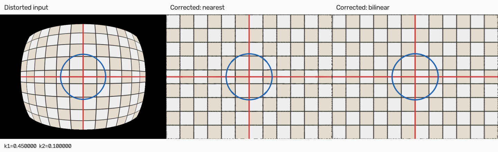

# DZO cvičenie 7 – Odstránenie radiálneho skreslenia

Riešenie [zadania Removal of Geometric Distortion](https://geordi.github.io/cv-courses/radial_lens_distortion.html)
v C++17 s OpenCV. Spätné mapovanie súradníc aj oba spôsoby interpolácie sú
implementované ručne v `main.cpp`. OpenCV zabezpečuje načítanie, uloženie,
zobrazenie a kreslenie ukážkovej mriežky. Korekcia nepoužíva `cv::undistort`
ani `cv::remap`.

## Spustenie

V PowerShelli:

```powershell
cd D:\DZOall\DZOcviko7
.\run.cmd
```

Skript pri každom spustení skompiluje program, nastaví cestu ku knižniciam
a otvorí porovnanie vstupu a oboch korekcií. Okno zatvoríš ľubovoľnou klávesou.
Používa existujúci MSYS2 MinGW64 a OpenCV v `C:\msys64\mingw64`.

```powershell
.\run.cmd --no-show                     # vytvorenie výstupov bez okna
.\run.cmd --self-test                   # iba automatické kontroly
.\run.cmd --help
.\run.cmd "D:\obrazky\foto.png" --k1 0.3 --k2 0.05
.\run.cmd "images\distorted_grid.png" --k1 0.45 --k2 0.1 --no-show
```

Koeficienty `--k1` a `--k2` sa zadávajú s desatinnou bodkou. Predvolené
hodnoty sú `0.45` a `0.10`; patria k vytvorenej ukážke. Pri vlastnej fotografii
treba zvoliť koeficienty pre daný objektív a obraz. Zadanie neobsahuje postup
kalibrácie a program koeficienty automaticky neodhaduje. Rozmery fotografie
zostávajú zachované, vstup sa načíta ako 8-bitový BGR obraz.

Alternatívne sa dá projekt zostaviť cez CMake s dostupným balíkom OpenCV:

```powershell
cmake -S . -B build-cmake
cmake --build build-cmake --config Release
```

## Výpočet podľa zadania

Pre každý pixel výstupného, opraveného obrazu `(xn, yn)`:

```text
cu = width / 2.0
cv = height / 2.0
R  = sqrt(cu*cu + cv*cv)

x_bar = (xn - cu) / R
y_bar = (yn - cv) / R
r2 = x_bar*x_bar + y_bar*y_bar

phi = 1 + k1*r2 + k2*r2*r2
xd = cu + (xn - cu) / phi
yd = cv + (yn - cv) / phi
```

Normalizácia používa rovnaké `R` pre obe osi, aby sa zachovala radiálna
symetria aj pri obdĺžnikovom obraze. Stred je presne `(width/2, height/2)`
podľa zadania. Zápis `phi^-1(r2)` v rovnici (3) je v riešení recipročný
faktor `1/phi(r2)`.

Výstupný pixel sa vyplní hodnotou zo vstupnej súradnice `(xd, yd)`.
Ide o spätné mapovanie: každý výstupný pixel sa spracuje práve raz.
Výsledky sa počítajú pre obe interpolácie:

- **Najbližší sused:** zaokrúhlenie `(xd, yd)` a skopírovanie pixelu.
- **Bilineárna:** vážený priemer štyroch susedov. Pre
  `a = xd - floor(xd)` a `b = yd - floor(yd)` sú váhy
  `(1-a)(1-b)`, `a(1-b)`, `(1-a)b`, `ab`. Každý farebný kanál sa
  interpoluje samostatne; zaokrúhľuje sa až výsledná hodnota.

Súradnice mimo rozsahu `[0,width-1] × [0,height-1]` vytvoria čierny pixel.
Na poslednom riadku a stĺpci sa sused ohraničí na okraj, takže sa nečíta
mimo pamäte. Program odmietne koeficienty, pre ktoré `phi` nie je kladné
na intervale `r2 ∈ [0,1]`, vrátane prípadného vnútorného minima polynómu.

Pri tejto konvencii kladný prvý koeficient s nulovým druhým opravuje
súdkovité skreslenie; záporný opravuje poduškovité. Pri kombinácii oboch
koeficientov rozhoduje celý priebeh radiálneho faktora.

## Ukážka a výsledky

Oba obrázky uvedené na stránke zadania (`distorted_image.eps` a
`human_adjusted_image.eps`) vracali pri príprave riešenia 14. 10. 2026 HTTP 404.
Predvolený beh preto vytvorí vlastnú referenčnú mriežku 720 × 540 a jej
súdkovito skreslenú verziu. Ide o syntetickú ukážku, nie o fotografiu zo zadania.

Pri generovaní skresleného vstupu sa numericky invertuje radiálna rovnica
`rd = rn / phi(rn²)` bisekciou. Samotná zmena znamienka koeficientov by
nebola presná inverzia. Generovanie ukážky vyžaduje monotónne mapovanie
na `rn ∈ [0,1]`; program túto podmienku kontroluje. Pri korekcii vlastnej
fotografie sa numerická inverzia nepoužíva, len priama rovnica (3).



Zakrivené čiary sa po korekcii narovnajú. Odchýlky voči referencii zostávajú
v dôsledku dvojitého prevzorkovania a chýbajúcich vzoriek pri hranici
skreslenej mriežky. Pre predvolenú ukážku vyšla priemerná absolútna chyba
na všetkých pixeloch a kanáloch, v intenzitnej škále 0 až 255:

| Interpolácia | MAE voči pôvodnej mriežke |
|---|---:|
| Najbližší sused | 4.68928 |
| Bilineárna | 4.97784 |

Bilineárna interpolácia vytvára plynulejšie hrany, ale na tejto mriežke
s ostrými prechodmi nemá nižšiu celkovú MAE. Číselné výsledky sa po novom
behu ukážky aktualizujú v `demo_metrics.csv`.

## Overenie

Program pred spracovaním vstupu vykoná automatické kontroly:

- známa hodnota mapovania pre obraz 8 × 6, `k1=k2=0.25`:
  roh `(0,0)` sa mapuje na `(4/3,1)` a stred `(4,3)` zostáva pevný;
- správne bilineárne váhy na lineárnom jasovom gradiente;
- celá korekcia s nenulovými koeficientmi na známom gradiente troch kanálov;
- zaokrúhlenie najbližšieho suseda, hranice a čierne pixely mimo obrazu;
- pixelovo totožný vstup a výstup pri `k1=k2=0` pre obe interpolácie,
  sivé aj farebné obrazy, párne a nepárne rozmery aj rozmery 1 × N a N × 1;
- odmietnutie modelu s nulou `phi` vo vnútri intervalu.

Pri chybe program skončí s nenulovým návratovým kódom.
Výpočet korekcie má časovú zložitosť `O(width × height)` a pamäťovú
zložitosť `O(width × height)` pre výstupný obraz.

## Súbory

| Súbor | Obsah |
|---|---|
| `main.cpp` | Model, ručné interpolácie, korekcia, ukážka a kontroly |
| `run.cmd` | Kompilácia a spustenie na tomto počítači |
| `CMakeLists.txt` | Alternatívne zostavenie |
| `zadanie.html` | Lokálna kópia stránky zadania |
| `images/grid_undistorted.png` | Referenčná mriežka bez skreslenia |
| `images/distorted_grid.png` | Syntetický vstup so známymi koeficientmi |
| `image.png` | Vstup posledného spracovania |
| `corrected_nearest.png` | Korekcia najbližším susedom |
| `corrected_bilinear.png` | Bilineárna korekcia |
| `result_images.png` | Porovnanie troch obrazov |
| `demo_difference.png` | Absolútny rozdiel bilineárnej korekcie a referencie |
| `demo_metrics.csv` | Chyby oboch korekcií voči referencii |

Výstupy v koreňovom priečinku sa pri spustení prepíšu. Súbory s prefixom
`demo_` a referenčné mriežky sa aktualizujú len pri behu bez vstupnej fotografie.
