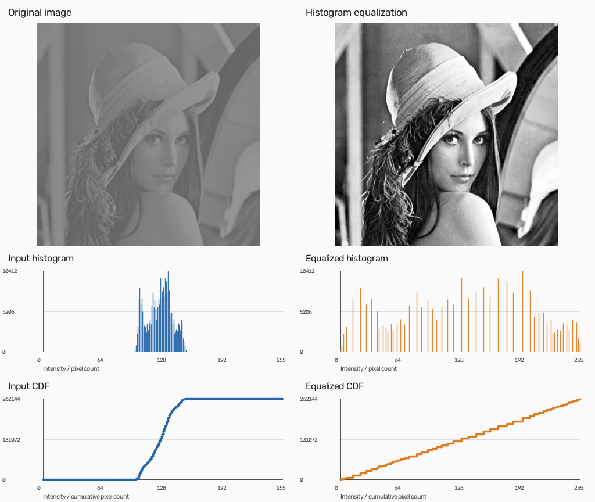

# DZO cvičenie 8 – Ekvalizácia histogramu

Riešenie [zadania Histogram Equalization](https://geordi.github.io/cv-courses/histogram_equalization.html)
v C++17 s OpenCV. Program ručne vypočíta histogram, kumulatívnu distribučnú
funkciu (CDF) a 256-prvkovú prevodovú tabuľku (LUT). Pomocou LUT upraví
jas každého pixelu. Nepoužíva `cv::equalizeHist`, `cv::calcHist` ani `cv::LUT`.

## Spustenie

V PowerShelli:

```powershell
cd D:\DZOall\DZOcviko8
.\run.cmd
```

Skript automaticky skompiluje `main.cpp` do `build/dzo_histogram.exe`,
vykoná kontroly, uloží výsledky a otvorí okno s porovnaním. Ľubovoľná klávesa
okno zatvorí. Používa existujúci kompilátor MSYS2 MinGW64 a OpenCV
v `C:\msys64\mingw64`; CMake nie je potrebný.

```powershell
.\run.cmd --no-show                     # výpočet a uloženie bez okna
.\run.cmd --self-test                   # iba automatické kontroly
.\run.cmd --help
.\run.cmd "D:\obrazky\foto.png" --no-show
.\run.cmd "images\lena_low_contrast.png" --output "output" --no-show
```

Vlastný vstup sa načíta ako 8-bitový sivý obraz a zachová si svoje rozmery.
Farebný vstup sa pri načítaní prevedie na sivý; ekvalizácia podľa zadania
pracuje s jedinou jasovou hodnotou, nie s nezávislými farebnými kanálmi.
Prepínač `--output` určuje priečinok pre výstupy, predvolene je to priečinok
cvičenia. Výstupné súbory sa pri ďalšom spustení prepíšu.

Alternatívne zostavenie s dostupným balíkom OpenCV:

```powershell
cmake -S . -B build-cmake
cmake --build build-cmake --config Release
```

## Postup podľa zadania

Pre 8-bitový obraz je počet jasových úrovní `L = 256`.

1. `histogram()` spočíta pixely jednotlivých intenzít: `hist[i] = n_i`.
2. `cumulativeDistribution()` vytvorí prefixový súčet:
   `cdf[i] = hist[0] + ... + hist[i]`.
3. `makeLookupTable()` nájde prvú nenulovú hodnotu `cdf_min` a použije
   vzorec zo zadania:

   ```text
   lut[v] = round((cdf[v] - cdf_min) / (width*height - cdf_min) * 255)
   ```

4. `applyLookupTable()` nahradí každý pixel hodnotou `lut[input_pixel]`.
5. Program z opraveného obrazu znovu vypočíta histogram a CDF a vytvorí
   porovnanie rovnakých šiestich veličín ako v ukážke na stránke.

Histogram aj CDF používajú 64-bitové neznamienkové počítadlá.
Vzorec sa vyhodnocuje v `double`; zaokrúhľuje sa až konečný jas pomocou
`std::lround`. Intenzity pod prvou obsadenou úrovňou majú v LUT nulu,
aby pri odčítaní `cdf_min` nedošlo k podtečeniu neznamienkového čísla.

Pri konštantnom obraze platí `width*height = cdf_min`, takže by vo vzorci
vzniklo delenie nulou. Riešenie vtedy použije identickú LUT a obraz zachová.
Rovnaké správanie má aj vstup s jediným pixelom.

## Ukážka a výsledok

Stránka zadania poskytuje ukážkový snímok obrazovky s krajinou, ktorý je
uložený v `reference/expected_output.png`. Samostatný vstupný obraz na
stránke nie je odkazovaný. Predvolená ukážka preto používa lokálnu Lenu
z cvičenia 4, skopírovanú do `images/lena_gray.png`.

Pred ekvalizáciou sa jej kontrast zníži prevodom:

```text
low_contrast[v] = 90 + round(70*v/255)
```

Tento prípravný krok sa vykonáva iba pri spustení bez vlastného vstupu.
Pri zadanej fotografii sa ekvalizuje priamo načítaný sivý obraz.



Pri overenom predvolenom behu pre obraz 512 × 512:

| Veličina | Vstup | Ekvalizovaný obraz |
|---|---:|---:|
| Minimálny jas | 97 | 0 |
| Maximálny jas | 157 | 255 |
| Priemerný jas | 124.052139 | 130.434349 |
| Smerodajná odchýlka jasu | 13.138142 | 73.582231 |

Počet pixelov je `262144` a `cdf_min = 27`. Rozsah jasov sa rozšíril
z 97–157 na 0–255, takže detaily sú výraznejšie. Histogram výstupu má
medzery: diskrétna ekvalizácia nedokáže rozdeliť pixely rovnakej vstupnej
intenzity medzi viaceré výstupné úrovne. Výstupná CDF je preto schodovitá
a približuje sa priamke; histogram nemusí byť dokonale rovnomerný.

Oba histogramy v porovnaní používajú spoločnú zvislú mierku, obe CDF
mierku 0 až počet pixelov. Grafy tak umožňujú priame porovnanie.
Číselné hodnoty sa ukladajú do CSV bez vizualizačného škálovania.

## Overenie

Program bol skompilovaný a spustený s `--no-show`. Pred každým spracovaním
vykonáva automatické kontroly:

- pre vstup `[50, 50, 100, 150]` overí histogram, CDF a presný výsledok
  `[0, 0, 128, 255]`, vrátane odčítania `cdf_min` a zaokrúhlenia `127.5`;
- konštantné obrazy s jasmi 0, 73 a 255 a obraz 1 × 1 zostanú nezmenené;
- rovnomerný histogram s každou úrovňou 0–255 práve raz zostane nezmenený;
- dvojúrovňový vstup `[30, 200]` sa prevedie na `[0, 255]`;
- výrez obrazu s nesúvislou pamäťou sa spracuje rovnako ako jeho kópia;
- prázdny vstup sa odmietne.

Kontroly pri reálnom spracovaní overujú aj monotónnosť LUT a oboch CDF,
počet pixelov a presun početností histogramu pomocou LUT. Pri chybe program
skončí s nenulovým návratovým kódom.

Časová zložitosť ekvalizácie je `O(width × height + L)`. Pomocná pamäť
histogramu, CDF a LUT je `O(L)`; nový obraz potrebuje `O(width × height)`.

## Súbory

| Súbor | Obsah |
|---|---|
| `main.cpp` | Vlastný histogram, CDF, LUT, ekvalizácia, grafy a kontroly |
| `run.cmd` | Kompilácia a spustenie |
| `CMakeLists.txt` | Alternatívne zostavenie |
| `zadanie.html` | Lokálna kópia zadania |
| `reference/expected_output.png` | Ukážkový výsledok zo stránky zadania |
| `images/lena_gray.png` | Lokálna kópia základného obrazu z cvičenia 4 |
| `images/lena_low_contrast.png` | Vstup predvolenej ukážky so zníženým kontrastom |
| `image.png` | Skutočný sivý vstup posledného spracovania |
| `equalized.png` | Ekvalizovaný obraz v pôvodnom rozlíšení |
| `histogram_input.png`, `histogram_equalized.png` | Grafy početností |
| `cdf_input.png`, `cdf_equalized.png` | Grafy kumulatívnych početností |
| `result_images.png` | Spoločné porovnanie šiestich panelov |
| `histogram.csv` | 256 riadkov: intenzita, vstupný histogram a CDF, LUT, výstupný histogram a CDF |
| `metrics.txt` | Rozmery, počet pixelov, `cdf_min` a štatistiky jasu |
